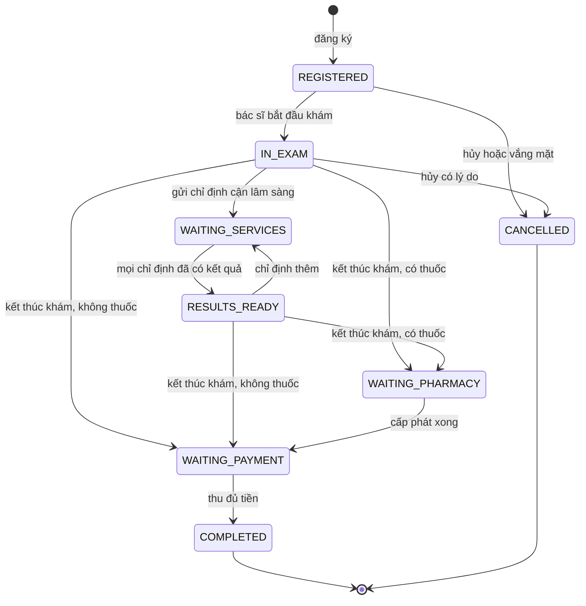
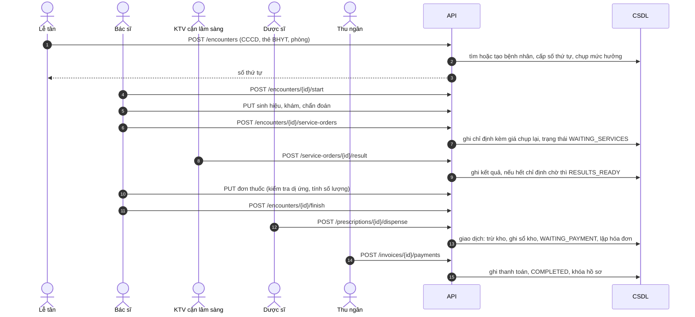
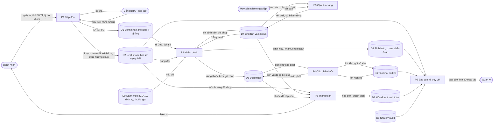
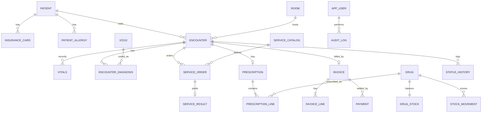

# HIS mini: đặc tả thiết kế

Tài liệu này mô tả **cái gì cần xây và vì sao**, không chứa code. Dùng làm đầu vào cho Claude Code.

## 0. Cách dùng với Claude Code

1. Tạo repo, chép file này vào `docs/SPEC.md`.
2. Tạo `CLAUDE.md` ở gốc repo bằng đoạn ở mục 16 để Claude Code luôn nhớ quy ước.
3. Làm theo từng milestone ở mục 13. Mỗi lần chỉ đưa một milestone, yêu cầu viết test trước hoặc cùng lúc, chạy test rồi mới sang bước tiếp.
4. Mọi chỗ ghi **[QUYẾT ĐỊNH]** là lựa chọn thiết kế, bạn có thể đổi nhưng nên đổi trong file này trước khi code.

---

## 1. Mục tiêu và phạm vi

**Mục tiêu:** mô phỏng đúng luồng khám bệnh **ngoại trú** của một bệnh viện, từ lúc đăng ký đến lúc thu tiền, với dữ liệu giả. Sản phẩm dùng để học và để minh họa trong báo cáo thực tập, không dùng cho bệnh nhân thật.

**Trong phạm vi (MVP):**

- Tiếp đón: hồ sơ bệnh nhân, thẻ BHYT, đăng ký khám, số thứ tự theo phòng.
- Khám bệnh: sinh hiệu, khám lâm sàng, chẩn đoán ICD-10, chỉ định cận lâm sàng, đơn thuốc.
- Cận lâm sàng: danh sách chờ, nhập kết quả.
- Dược: cấp phát, tồn kho.
- Thanh toán: hóa đơn, phần BHYT chi trả và phần bệnh nhân trả.
- Hồ sơ bệnh án điện tử tóm tắt, báo cáo, nhật ký truy vết, phân quyền.

**Ngoài phạm vi (ghi rõ để không bị kéo rộng):** nội trú, phẫu thuật, nhân sự và trang thiết bị, kế toán, kết nối thật với BHXH hay VNeID hay máy xét nghiệm, ký số pháp lý, ứng dụng bệnh nhân. Các điểm này được thiết kế sẵn chỗ cắm (mục 8) nhưng chỉ làm bản giả lập.

**Nguyên tắc thiết kế:**

1. Mỗi lượt khám đi qua một **máy trạng thái duy nhất**, mọi chuyển trạng thái qua một chỗ.
2. **Chụp lại giá tại thời điểm chỉ định** (snapshot), đổi bảng giá sau này không làm đổi hóa đơn cũ.
3. **Mọi thay đổi dữ liệu đều có nhật ký**, nhật ký chỉ thêm, không sửa, không xóa.
4. **Tiền là số nguyên đồng**, không dùng số thực.
5. Kiểm tra nghiệp vụ nằm ở **server**. Giao diện chỉ gợi ý.

---

## 2. Vai trò và quyền

| Vai trò | Mô tả |
|---|---|
| `RECEPTION` | Lễ tân tiếp đón |
| `DOCTOR` | Bác sĩ |
| `LAB_TECH` | Kỹ thuật viên xét nghiệm và chẩn đoán hình ảnh |
| `PHARMACIST` | Dược sĩ |
| `CASHIER` | Thu ngân |
| `MANAGER` | Quản lý, xem báo cáo |
| `ADMIN` | Quản trị danh mục và người dùng |

Ma trận quyền (C tạo, R xem, U sửa, X thực hiện hành động đặc biệt, dấu - là không có quyền):

| Chức năng | RECEPTION | DOCTOR | LAB_TECH | PHARMACIST | CASHIER | MANAGER | ADMIN |
|---|---|---|---|---|---|---|---|
| Hồ sơ bệnh nhân hành chính | C R U | R | R (tối thiểu) | R (tối thiểu) | R (tối thiểu) | R | R |
| Thẻ BHYT | C R U | R | - | - | R | R | - |
| Đăng ký khám, hủy lượt | C R X | R | - | - | R | R | - |
| Sinh hiệu, khám, chẩn đoán | - | C R U | - | - | - | - | - |
| Chỉ định cận lâm sàng | - | C R | R | - | - | - | - |
| Kết quả cận lâm sàng | - | R | C R U | - | - | - | - |
| Đơn thuốc | - | C R U | - | R | - | - | - |
| Cấp phát, tồn kho | - | R (tồn) | - | X R | - | R | - |
| Hóa đơn, thu tiền | - | - | - | - | X R | R | - |
| Báo cáo | - | - | - | - | - | R | R |
| Nhật ký truy vết | - | - | - | - | - | R | R |
| Danh mục, người dùng | - | - | - | - | - | - | C R U |

"Tối thiểu" nghĩa là chỉ thấy họ tên, tuổi, giới, mã bệnh nhân, không thấy CCCD, địa chỉ hay bệnh sử. **[QUYẾT ĐỊNH]** Đây là nguyên tắc cần-biết, nên giữ vì phản ánh đúng yêu cầu bảo mật dữ liệu y tế.

---

## 3. Kiến trúc

```
┌──────────────────────────────────────────────────────────┐
│ Web (một ứng dụng, menu theo vai trò)                    │
└───────────────▲──────────────────────────────────────────┘
                │ REST + SSE (đẩy số lượng hàng đợi)
┌───────────────┴──────────────────────────────────────────┐
│ API                                                      │
│  Lớp HTTP: xác thực, phân quyền, kiểm tra đầu vào        │
│  Lớp ứng dụng: các use case (RegisterEncounter, ...)     │
│  Lớp miền: máy trạng thái, tính tiền, kiểm tra dị ứng    │
│  Lớp tích hợp: các "cổng" (port) + bản giả lập (mock)    │
│  Lớp dữ liệu: repository + giao dịch                     │
└───────────────┬──────────────────────────────────────────┘
                │
        ┌───────┴────────┐
        │ PostgreSQL     │  dữ liệu nghiệp vụ + audit
        └────────────────┘
```

**[QUYẾT ĐỊNH] Kiến trúc:** một ứng dụng backend dạng **modular monolith**. Mỗi module (patients, encounters, orders, pharmacy, billing, audit...) có ranh giới rõ nhưng chạy chung một tiến trình và một CSDL. Không dùng microservices vì chỉ thêm độ phức tạp vận hành mà không có lợi ích ở quy mô này.

**Gợi ý công nghệ (đổi theo cái bạn quen):**

| Lớp | Gợi ý | Ghi chú |
|---|---|---|
| CSDL | PostgreSQL 16 | Bắt buộc có giao dịch, ràng buộc, kiểu enum |
| Backend | TypeScript với NestJS, hoặc Python với FastAPI, hoặc Java Spring | Nhiều hãng HIS trong nước dùng Java, nhưng stack nào cũng được |
| ORM và migration | Prisma, SQLAlchemy hoặc Flyway | Phải có migration, không sửa schema bằng tay |
| Frontend | React với Vite, TanStack Query, thư viện form có kiểm tra schema | |
| Xác thực | Phiên đăng nhập có hạn hoặc JWT ngắn hạn kèm refresh | Mật khẩu băm bằng argon2 hoặc bcrypt |
| Kiểm thử | Test đơn vị cho miền, test tích hợp có CSDL thật (Testcontainers), e2e bằng Playwright | |
| Chạy cục bộ | `docker-compose` cho Postgres | |

**Cấu trúc thư mục gợi ý:**

```
his-mini/
  CLAUDE.md
  docs/SPEC.md
  docker-compose.yml
  apps/api/
    src/modules/{auth,patients,insurance,encounters,clinical,orders,lab,pharmacy,billing,reports,audit,catalog}
    src/domain/{encounter-state-machine,pricing,allergy,prescription-quantity}
    src/integrations/{insurance,identity,lis,pacs,esign,fhir}/   # port + mock
    migrations/
    seeds/
  apps/web/src/features/{reception,exam,lab,pharmacy,cashier,records,reports,audit}
  packages/shared/   # enum trạng thái, schema kiểm tra dùng chung
```

---

## 4. Luồng nghiệp vụ

### 4.1 Vòng đời một lượt khám (`encounter.status`)



Bảng chuyển trạng thái (nguồn sự thật duy nhất, cài đặt thành một bảng dữ liệu trong code và test từng dòng):

| Từ | Sang | Lệnh | Vai trò | Điều kiện (phải đúng, nếu không trả lỗi 409) |
|---|---|---|---|---|
| (mới) | REGISTERED | `register` | RECEPTION | Danh tính hợp lệ, không có lượt khám đang mở cùng phòng cùng ngày (trừ khi xác nhận) |
| REGISTERED | IN_EXAM | `start` | DOCTOR | Không có |
| REGISTERED, IN_EXAM | CANCELLED | `cancel` | RECEPTION, DOCTOR | Có lý do. Không hủy khi đã có chỉ định đã thực hiện hoặc đơn đã cấp |
| IN_EXAM, RESULTS_READY | WAITING_SERVICES | `order_services` | DOCTOR | Ít nhất một dịch vụ, đang ở trạng thái cho phép sửa |
| WAITING_SERVICES | RESULTS_READY | tự động | hệ thống | Mọi chỉ định `RESULTED` hoặc `CANCELLED` |
| IN_EXAM, RESULTS_READY | WAITING_PHARMACY hoặc WAITING_PAYMENT | `finish` | DOCTOR | Có đúng một chẩn đoán chính, không còn chỉ định chờ, đơn không vi phạm dị ứng. Có dòng thuốc thì sang WAITING_PHARMACY |
| WAITING_PHARMACY | WAITING_PAYMENT | `dispense` | PHARMACIST | Đủ tồn kho cho mọi dòng, thực hiện nguyên tử |
| WAITING_PAYMENT | COMPLETED | `pay` | CASHIER | Số tiền thu đúng bằng phần bệnh nhân trả |

Mọi lần chuyển ghi một dòng vào `encounter_status_history` (từ, sang, người làm, lúc nào, ghi chú).

### 4.2 Luồng chính theo trình tự



### 4.3 Dòng dữ liệu: ai tạo, ai đọc, khi nào bất biến

| Dữ liệu | Được tạo ở | Được đọc ở | Bất biến khi |
|---|---|---|---|
| Bệnh nhân (hành chính) | Tiếp đón | Mọi bước (theo quyền) | Không khóa, mọi sửa đổi có nhật ký |
| Thẻ BHYT | Tiếp đón | Tiếp đón, thanh toán | Mức hưởng được chụp vào lượt khám lúc đăng ký |
| Lượt khám | Tiếp đón | Mọi bước | `COMPLETED` |
| Sinh hiệu, khám, chẩn đoán | Khám bệnh | Bác sĩ, hồ sơ, báo cáo | Khi bấm `finish`, sau đó chỉ sửa qua bản điều chỉnh có lý do |
| Chỉ định cận lâm sàng | Khám bệnh | Cận lâm sàng, hóa đơn | Khi đã có kết quả |
| Kết quả | Cận lâm sàng | Bác sĩ, hồ sơ | Khi lưu. Sửa phải tạo bản điều chỉnh |
| Đơn thuốc | Khám bệnh | Dược, hóa đơn | Khi cấp phát |
| Sổ kho | Dược | Dược, báo cáo | Luôn (chỉ thêm) |
| Hóa đơn | Khi vào WAITING_PAYMENT | Thu ngân, báo cáo | Khi `PAID` |
| Nhật ký | Mọi bước | Quản lý, quản trị | Luôn |

### 4.4 Dòng tiền

```
Phí khám (danh mục, mã EXAM)         ─┐
Cận lâm sàng đã có kết quả (giá chụp) ─┼─> dòng hóa đơn ─> tổng
Thuốc đã cấp phát (giá chụp)          ─┘
mỗi dòng: nếu thuộc danh mục BHYT và lượt khám có mức hưởng
          bhyt_tra = làm tròn(thành_tiền × mức_hưởng / 100)
          bệnh_nhân_tra = thành_tiền − bhyt_tra
```

**[QUYẾT ĐỊNH]** Cách tính BHYT ở trên là **bản đơn giản hóa**. Cài thành một giao diện `PricingPolicy` để thay thế sau. Thực tế còn tuyến khám, thông tuyến, đồng chi trả, trần thanh toán, đối tượng ưu tiên. Ghi rõ điều này trong báo cáo thực tập, đừng trình bày như quy định thật.

### 4.5 Sơ đồ luồng dữ liệu (DFD cấp 1)

Hình tròn bo là thực thể bên ngoài, hình chữ nhật là tiến trình, hình trụ là kho dữ liệu. Mũi tên ghi **dữ liệu nào** đi theo hướng đó.



**Quy tắc đi kèm sơ đồ** (không vẽ mũi tên cho gọn):

- Mọi tiến trình P1 đến P5 đều ghi vào **D8** trong cùng giao dịch với thay đổi dữ liệu (`BR-AUD-1`).
- Mỗi module **chỉ ghi vào bảng của chính nó**. Muốn đổi dữ liệu module khác thì gọi service của module đó. Ví dụ P3 không tự cập nhật `encounter.status`, mà gọi lệnh của máy trạng thái.
- Sự kiện nội bộ chỉ phát **sau khi commit**, không phát trong giao dịch.
- Ba **điểm chụp dữ liệu** (snapshot), sau đó dữ liệu không đổi theo danh mục nữa: mức hưởng BHYT lúc đăng ký, giá dịch vụ lúc chỉ định, giá thuốc lúc kê đơn.

### 4.6 Ma trận đọc và ghi theo từng bước

Mỗi hàng là một giao dịch. Cột "Ghi" là những bảng thay đổi trong giao dịch đó (kèm một dòng `audit_log` và, nếu đổi trạng thái, một dòng `encounter_status_history`).

| Bước | Ai | API | Đọc | Ghi | Trạng thái | Sự kiện phát |
|---|---|---|---|---|---|---|
| S1 Tìm hoặc tạo hồ sơ | Lễ tân | `GET /patients/lookup`, `POST /patients` | `patient`, `insurance_card` | `patient`, `patient_allergy`, `insurance_card` | không đổi | không có |
| S2 Đăng ký lượt khám | Lễ tân | `POST /encounters` | `patient`, `insurance_card`, `room`, `encounter` (kiểm tra trùng) | `room_queue_counter`, `encounter` (kèm `benefit_rate_snapshot`) | (mới) thành REGISTERED | `EncounterRegistered` |
| S3 Bắt đầu khám | Bác sĩ | `POST /encounters/{id}/start` | `encounter`, `patient`, `patient_allergy`, các `encounter` trước đó | `encounter` (`started_at`, `doctor_id`) | REGISTERED thành IN_EXAM | `ExamStarted` |
| S4 Ghi sinh hiệu, khám, chẩn đoán | Bác sĩ | `PUT .../vitals`, `.../exam`, `.../diagnoses` | `icd10`, `encounter` | `vitals`, `encounter.exam_text`, `encounter_diagnosis` | không đổi | không có |
| S5 Gửi chỉ định | Bác sĩ | `POST .../service-orders` | `service_catalog` | `service_order` (chụp giá và diện BHYT) | IN_EXAM hoặc RESULTS_READY thành WAITING_SERVICES | `ServicesOrdered` |
| S6 Trả kết quả | KTV | `POST /service-orders/{id}/result` | `service_order`, `encounter` | `service_result`, `service_order.status`, và `encounter.status` nếu hết chỉ định chờ | WAITING_SERVICES thành RESULTS_READY khi đủ | `ServiceResulted`, `ResultsReady` |
| S7 Kê đơn | Bác sĩ | `PUT .../prescription` | `drug`, `patient_allergy`, `drug_stock` (chỉ để cảnh báo) | `prescription`, `prescription_line` (server tính số lượng, chụp giá) | không đổi | không có |
| S8 Kết thúc khám | Bác sĩ | `POST .../finish` | `encounter_diagnosis`, `service_order`, `prescription` | `encounter` (`finished_at`, `locked_at`), `record_signature` | thành WAITING_PHARMACY nếu có thuốc, ngược lại WAITING_PAYMENT | `ExamFinished` |
| S9 Cấp phát | Dược sĩ | `POST /prescriptions/{id}/dispense` | `prescription_line`, `drug_stock` | `drug_stock` (trừ), `stock_movement`, `prescription` | WAITING_PHARMACY thành WAITING_PAYMENT | `PrescriptionDispensed` |
| S10 Lập hóa đơn | hệ thống, chạy trong S8 hoặc S9 | nội bộ | `encounter.benefit_rate_snapshot`, `service_order` (RESULTED), `prescription_line` (đã cấp), `service_catalog` (mã EXAM) | `invoice`, `invoice_line` | không đổi | `InvoiceIssued` |
| S11 Thu tiền | Thu ngân | `POST /invoices/{id}/payments` | `invoice` | `payment`, `invoice.status`, `encounter` (`completed_at`) | WAITING_PAYMENT thành COMPLETED | `PaymentCompleted` |
| S12 Báo cáo, truy vết | Quản lý | `GET /reports/*`, `GET /audit` | mọi bảng (qua truy vấn tổng hợp) | không có | không đổi | không có |

Hai điểm cần chú ý khi code:

- S10 có hai nguồn kích hoạt: S9 (có thuốc) hoặc S8 (không có thuốc). Viết một hàm lập hóa đơn dùng chung, đừng chép hai bản.
- S5 và S6 có thể lặp nhiều vòng (bác sĩ chỉ định thêm sau khi có kết quả). Khi lập hóa đơn, chỉ lấy chỉ định `RESULTED`, bỏ qua `CANCELLED`.

### 4.7 Ví dụ vết dữ liệu của một lượt khám

Bệnh nhân có thẻ BHYT mức hưởng 80%, khám phòng Nội, bác sĩ chỉ định xét nghiệm máu và kê Amoxicillin 1 viên, 2 lần mỗi ngày, 7 ngày. Giá lấy từ dữ liệu mẫu.

| Bước | Dòng được thêm hoặc sửa |
|---|---|
| S2 | `encounter` mới: `NOI-001`, `benefit_rate_snapshot = 80`, status REGISTERED |
| S3 | `encounter.status = IN_EXAM`, `started_at` có giá trị |
| S4 | `vitals` (nhiệt độ 38,2), `encounter_diagnosis` (J20.9, chính) |
| S5 | `service_order` XN01, `price_snapshot = 45000`, `covered_snapshot = true`. Status chuyển WAITING_SERVICES |
| S6 | `service_result` cho XN01, `service_order.status = RESULTED`, encounter chuyển RESULTS_READY |
| S7 | `prescription_line` Amoxicillin: quantity = ceil(1 × 2 × 7) = 14, `price_snapshot = 2500` |
| S8 | `encounter.locked_at` có giá trị, status WAITING_PHARMACY |
| S9 | `drug_stock` giảm 14, `stock_movement` delta = −14, status WAITING_PAYMENT |
| S10 | `invoice` và 3 dòng: phí khám 40.000, xét nghiệm 45.000, thuốc 14 × 2.500 = 35.000 |
| S11 | `payment` 24.000, `invoice.status = PAID`, encounter COMPLETED |

Tính hóa đơn: tổng 120.000. BHYT trả 80% mỗi dòng (32.000 + 36.000 + 28.000 = 96.000). Bệnh nhân trả 24.000. Ví dụ này nên dùng làm test chuẩn cho `PricingPolicy` ở M5.

### 4.8 Dữ liệu đi ra ngoài hệ thống

| Hướng ra | Từ đâu | Dạng | Ghi chú |
|---|---|---|---|
| Báo cáo cho quản lý | D2, D3, D4, D6, D7 | Truy vấn tổng hợp, hiển thị màn hình | Không chứa định danh cá nhân khi chỉ cần số liệu |
| Xuất liên thông | D1, D2, D3, D4, D5 | JSON FHIR (mục 8) | Chạy qua `HealthRecordExporter`, ghi audit `EXPORT` |
| Truy vết | D8 | Danh sách thao tác theo bệnh nhân hoặc người dùng | Chỉ quản lý và quản trị |
| Biên lai | D7 | Màn hình hoặc bản in | Chỉ đủ thông tin thanh toán |

---

## 5. Mô hình dữ liệu

### 5.1 Sơ đồ quan hệ



### 5.2 Lược đồ PostgreSQL

```sql
-- Kiểu liệt kê
CREATE TYPE sex AS ENUM ('MALE','FEMALE');
CREATE TYPE user_role AS ENUM ('RECEPTION','DOCTOR','LAB_TECH','PHARMACIST','CASHIER','MANAGER','ADMIN');
CREATE TYPE encounter_status AS ENUM ('REGISTERED','IN_EXAM','WAITING_SERVICES','RESULTS_READY',
  'WAITING_PHARMACY','WAITING_PAYMENT','COMPLETED','CANCELLED');
CREATE TYPE order_status AS ENUM ('ORDERED','RESULTED','CANCELLED');
CREATE TYPE rx_status AS ENUM ('ISSUED','DISPENSED','CANCELLED');
CREATE TYPE invoice_status AS ENUM ('OPEN','PAID','VOID');
CREATE TYPE service_group AS ENUM ('EXAM','LAB','IMAGING','FUNCTIONAL');

CREATE TABLE app_user (
  id uuid PRIMARY KEY DEFAULT gen_random_uuid(),
  username text UNIQUE NOT NULL,
  full_name text NOT NULL,
  password_hash text NOT NULL,
  role user_role NOT NULL,
  active boolean NOT NULL DEFAULT true
);

CREATE TABLE room (
  id uuid PRIMARY KEY DEFAULT gen_random_uuid(),
  code text UNIQUE NOT NULL,          -- ví dụ 'NOI', dùng làm tiền tố số thứ tự
  name text NOT NULL
);

-- Danh tính: trẻ em và người nước ngoài có thể không có CCCD
CREATE TABLE patient (
  id uuid PRIMARY KEY DEFAULT gen_random_uuid(),
  code text UNIQUE NOT NULL,          -- BN00001, sinh từ SEQUENCE
  id_type text NOT NULL CHECK (id_type IN ('CCCD','BIRTH_CERT','PASSPORT','OTHER')),
  id_number text NOT NULL,
  full_name text NOT NULL,
  full_name_norm text NOT NULL,       -- chữ thường, bỏ dấu, gộp khoảng trắng; dùng dò trùng
  dob date NOT NULL CHECK (dob <= current_date),
  sex sex NOT NULL,
  phone text,
  address text,
  created_at timestamptz NOT NULL DEFAULT now(),
  updated_at timestamptz NOT NULL DEFAULT now(),
  UNIQUE (id_type, id_number),
  CHECK (id_type <> 'CCCD' OR id_number ~ '^[0-9]{12}$')
);
CREATE INDEX patient_dup_idx ON patient (full_name_norm, dob);

CREATE TABLE patient_allergy (
  id uuid PRIMARY KEY DEFAULT gen_random_uuid(),
  patient_id uuid NOT NULL REFERENCES patient(id),
  drug_class text NOT NULL,           -- 'PENICILLIN','NSAID','SULFA',...
  severity text,
  note text,
  UNIQUE (patient_id, drug_class)
);

CREATE TABLE insurance_card (
  id uuid PRIMARY KEY DEFAULT gen_random_uuid(),
  patient_id uuid NOT NULL REFERENCES patient(id),
  card_no char(15) NOT NULL CHECK (card_no ~ '^[A-Z]{2}[0-9]{13}$'),
  benefit_rate smallint NOT NULL CHECK (benefit_rate IN (80,95,100)),
  valid_from date NOT NULL,
  valid_to date NOT NULL CHECK (valid_to >= valid_from),
  verified_at timestamptz,
  verify_source text,                 -- 'MANUAL' hoặc tên cổng tra cứu
  UNIQUE (patient_id, card_no)
);

CREATE TABLE icd10 (code text PRIMARY KEY, name_vi text NOT NULL);

CREATE TABLE service_catalog (
  id uuid PRIMARY KEY DEFAULT gen_random_uuid(),
  code text UNIQUE NOT NULL,
  name text NOT NULL,
  grp service_group NOT NULL,
  price bigint NOT NULL CHECK (price >= 0),
  insurance_covered boolean NOT NULL,
  active boolean NOT NULL DEFAULT true
);

CREATE TABLE drug (
  id uuid PRIMARY KEY DEFAULT gen_random_uuid(),
  code text UNIQUE NOT NULL,
  name text NOT NULL,
  unit text NOT NULL,
  allergy_class text,                 -- khớp patient_allergy.drug_class
  price bigint NOT NULL CHECK (price >= 0),
  insurance_covered boolean NOT NULL,
  reorder_level int NOT NULL DEFAULT 60,
  active boolean NOT NULL DEFAULT true
);
CREATE TABLE drug_stock (
  drug_id uuid PRIMARY KEY REFERENCES drug(id),
  qty int NOT NULL CHECK (qty >= 0)
);
CREATE TABLE stock_movement (            -- sổ kho, chỉ thêm
  id bigserial PRIMARY KEY,
  drug_id uuid NOT NULL REFERENCES drug(id),
  delta int NOT NULL CHECK (delta <> 0),
  reason text NOT NULL CHECK (reason IN ('RECEIPT','DISPENSE','ADJUST','REVERSAL')),
  ref_type text, ref_id uuid,
  actor_id uuid REFERENCES app_user(id),
  at timestamptz NOT NULL DEFAULT now()
);

-- Bộ đếm số thứ tự theo phòng và ngày
CREATE TABLE room_queue_counter (
  room_id uuid REFERENCES room(id),
  queue_date date,
  last_no int NOT NULL,
  PRIMARY KEY (room_id, queue_date)
);

CREATE TABLE encounter (
  id uuid PRIMARY KEY DEFAULT gen_random_uuid(),
  code text UNIQUE NOT NULL,          -- LK20261006-001
  patient_id uuid NOT NULL REFERENCES patient(id),
  room_id uuid NOT NULL REFERENCES room(id),
  queue_date date NOT NULL,
  queue_no int NOT NULL,
  status encounter_status NOT NULL DEFAULT 'REGISTERED',
  insurance_card_id uuid REFERENCES insurance_card(id),
  benefit_rate_snapshot smallint NOT NULL DEFAULT 0,   -- 0 nếu không thẻ hoặc thẻ hết hạn
  chief_complaint text,
  exam_text text,
  registered_by uuid REFERENCES app_user(id),
  doctor_id uuid REFERENCES app_user(id),
  registered_at timestamptz NOT NULL DEFAULT now(),
  started_at timestamptz, finished_at timestamptz, completed_at timestamptz,
  locked_at timestamptz,
  version int NOT NULL DEFAULT 1,     -- khóa lạc quan
  UNIQUE (room_id, queue_date, queue_no)
);
CREATE INDEX encounter_status_idx ON encounter (status, registered_at);
CREATE INDEX encounter_patient_idx ON encounter (patient_id, registered_at DESC);

CREATE TABLE encounter_status_history (
  id bigserial PRIMARY KEY,
  encounter_id uuid NOT NULL REFERENCES encounter(id),
  from_status encounter_status, to_status encounter_status NOT NULL,
  actor_id uuid REFERENCES app_user(id),
  note text,
  at timestamptz NOT NULL DEFAULT now()
);

CREATE TABLE vitals (
  id uuid PRIMARY KEY DEFAULT gen_random_uuid(),
  encounter_id uuid NOT NULL REFERENCES encounter(id),
  measured_at timestamptz NOT NULL DEFAULT now(),
  temp_c numeric(3,1) CHECK (temp_c BETWEEN 30 AND 45),
  pulse smallint CHECK (pulse BETWEEN 20 AND 250),
  bp_sys smallint, bp_dia smallint,
  spo2 smallint CHECK (spo2 BETWEEN 0 AND 100),
  weight_kg numeric(5,1) CHECK (weight_kg > 0),
  measured_by uuid REFERENCES app_user(id)
);

CREATE TABLE encounter_diagnosis (
  encounter_id uuid NOT NULL REFERENCES encounter(id),
  icd10_code text NOT NULL REFERENCES icd10(code),
  is_primary boolean NOT NULL DEFAULT false,
  note text,
  PRIMARY KEY (encounter_id, icd10_code)
);
-- tối đa một chẩn đoán chính mỗi lượt khám
CREATE UNIQUE INDEX one_primary_dx ON encounter_diagnosis (encounter_id) WHERE is_primary;

CREATE TABLE service_order (
  id uuid PRIMARY KEY DEFAULT gen_random_uuid(),
  encounter_id uuid NOT NULL REFERENCES encounter(id),
  service_id uuid NOT NULL REFERENCES service_catalog(id),
  status order_status NOT NULL DEFAULT 'ORDERED',
  price_snapshot bigint NOT NULL,
  covered_snapshot boolean NOT NULL,
  ordered_by uuid REFERENCES app_user(id),
  ordered_at timestamptz NOT NULL DEFAULT now(),
  UNIQUE (encounter_id, service_id)
);
CREATE TABLE service_result (
  id uuid PRIMARY KEY DEFAULT gen_random_uuid(),
  order_id uuid UNIQUE NOT NULL REFERENCES service_order(id),
  result_text text NOT NULL,
  result_json jsonb,                  -- chỉ số có cấu trúc nếu cần
  is_abnormal boolean NOT NULL DEFAULT false,
  resulted_by uuid REFERENCES app_user(id),
  resulted_at timestamptz NOT NULL DEFAULT now()
);

CREATE TABLE prescription (
  id uuid PRIMARY KEY DEFAULT gen_random_uuid(),
  encounter_id uuid UNIQUE NOT NULL REFERENCES encounter(id),
  status rx_status NOT NULL DEFAULT 'ISSUED',
  issued_at timestamptz NOT NULL DEFAULT now(),
  dispensed_by uuid REFERENCES app_user(id),
  dispensed_at timestamptz
);
CREATE TABLE prescription_line (
  id uuid PRIMARY KEY DEFAULT gen_random_uuid(),
  prescription_id uuid NOT NULL REFERENCES prescription(id),
  drug_id uuid NOT NULL REFERENCES drug(id),
  dose_per_time numeric(5,2) NOT NULL CHECK (dose_per_time > 0),
  times_per_day smallint NOT NULL CHECK (times_per_day > 0),
  days smallint NOT NULL CHECK (days > 0),
  quantity int NOT NULL CHECK (quantity > 0),   -- server tính, bỏ qua giá trị client gửi
  price_snapshot bigint NOT NULL,
  covered_snapshot boolean NOT NULL,
  instruction text
);

CREATE TABLE invoice (
  id uuid PRIMARY KEY DEFAULT gen_random_uuid(),
  encounter_id uuid UNIQUE NOT NULL REFERENCES encounter(id),
  status invoice_status NOT NULL DEFAULT 'OPEN',
  benefit_rate smallint NOT NULL,
  total bigint NOT NULL,
  insurance_amount bigint NOT NULL,
  patient_amount bigint NOT NULL,
  created_at timestamptz NOT NULL DEFAULT now(),
  CHECK (total = insurance_amount + patient_amount)
);
CREATE TABLE invoice_line (
  id uuid PRIMARY KEY DEFAULT gen_random_uuid(),
  invoice_id uuid NOT NULL REFERENCES invoice(id),
  kind text NOT NULL CHECK (kind IN ('EXAM','SERVICE','DRUG')),
  ref_id uuid,
  name text NOT NULL,
  qty int NOT NULL,
  unit_price bigint NOT NULL,
  total bigint NOT NULL,
  insurance_amount bigint NOT NULL,
  patient_amount bigint NOT NULL,
  CHECK (total = insurance_amount + patient_amount)
);
CREATE TABLE payment (
  id uuid PRIMARY KEY DEFAULT gen_random_uuid(),
  invoice_id uuid NOT NULL REFERENCES invoice(id),
  method text NOT NULL CHECK (method IN ('CASH','TRANSFER','CARD')),
  amount bigint NOT NULL CHECK (amount > 0),
  idempotency_key text UNIQUE,
  paid_at timestamptz NOT NULL DEFAULT now(),
  cashier_id uuid REFERENCES app_user(id)
);

-- Ký xác nhận hồ sơ (bản giả lập: băm nội dung + người ký + thời điểm)
CREATE TABLE record_signature (
  id uuid PRIMARY KEY DEFAULT gen_random_uuid(),
  encounter_id uuid NOT NULL REFERENCES encounter(id),
  doc_type text NOT NULL,             -- 'EXAM_SUMMARY','LAB_RESULT','PRESCRIPTION'
  doc_hash text NOT NULL,
  signer_id uuid NOT NULL REFERENCES app_user(id),
  method text NOT NULL DEFAULT 'MOCK',
  signed_at timestamptz NOT NULL DEFAULT now()
);

-- Điều chỉnh sau khi khóa hồ sơ: không sửa đè, ghi bản mới kèm lý do
CREATE TABLE record_amendment (
  id uuid PRIMARY KEY DEFAULT gen_random_uuid(),
  encounter_id uuid NOT NULL REFERENCES encounter(id),
  entity_type text NOT NULL, entity_id text NOT NULL,
  before jsonb NOT NULL, after jsonb NOT NULL,
  reason text NOT NULL,
  actor_id uuid NOT NULL REFERENCES app_user(id),
  at timestamptz NOT NULL DEFAULT now()
);

CREATE TABLE audit_log (                -- chỉ thêm
  id bigserial PRIMARY KEY,
  at timestamptz NOT NULL DEFAULT now(),
  actor_id uuid, actor_role text,
  action text NOT NULL,               -- 'REGISTER','VIEW_CHART','DISPENSE','PAY',...
  entity_type text NOT NULL, entity_id text NOT NULL,
  patient_id uuid, encounter_id uuid,
  request_id text, ip inet,
  detail jsonb
);
CREATE INDEX audit_patient_idx ON audit_log (patient_id, at DESC);
-- Thu hồi UPDATE và DELETE trên audit_log, và thêm trigger chặn để chắc chắn.
```

### 5.3 Cấp số thứ tự an toàn khi nhiều lễ tân cùng đăng ký

Trong cùng giao dịch đăng ký, tăng bộ đếm bằng một câu lệnh duy nhất:
`INSERT INTO room_queue_counter ... ON CONFLICT (room_id, queue_date) DO UPDATE SET last_no = room_queue_counter.last_no + 1 RETURNING last_no`. Nhãn hiển thị là `{mã_phòng}-{số 3 chữ số}`, ví dụ `NOI-007`.

### 5.4 Trừ kho an toàn

Trong một giao dịch cấp phát: gom số lượng theo thuốc, **sắp xếp theo `drug_id`** để tránh khóa chéo, với mỗi thuốc chạy
`UPDATE drug_stock SET qty = qty - $n WHERE drug_id = $d AND qty >= $n`.
Nếu có câu lệnh nào cập nhật 0 dòng thì hoàn tác cả giao dịch và trả lỗi `INSUFFICIENT_STOCK` kèm tên thuốc, số cần, số còn. Thành công thì ghi `stock_movement` cho từng thuốc.

---

## 6. Quy tắc nghiệp vụ

Mỗi quy tắc cần ít nhất một test.

**Danh tính**

- `BR-ID-1` CCCD đúng 12 chữ số. Trẻ em và người nước ngoài dùng loại giấy tờ khác (`id_type`).
- `BR-ID-2` Cùng giấy tờ nhưng khác họ tên thì **từ chối** và chỉ ra mã hồ sơ đang giữ giấy tờ đó.
- `BR-ID-3` Chưa có giấy tờ trùng nhưng trùng (họ tên chuẩn hóa, ngày sinh) thì **cảnh báo** và buộc người dùng chọn: dùng hồ sơ cũ hoặc tạo mới có xác nhận (`confirm_new=true`). Lựa chọn được ghi nhật ký.
- `BR-ID-4` Tìm hồ sơ theo giấy tờ trả về hồ sơ cũ để điền sẵn. Nhân viên phải xác nhận thông tin còn đúng.

**BHYT**

- `BR-INS-1` Số thẻ gồm 2 chữ cái và 13 chữ số, ngày hiệu lực hợp lệ.
- `BR-INS-2` Thẻ chưa có hiệu lực hoặc hết hạn vào ngày khám thì mức hưởng áp dụng là 0 và hiện cảnh báo. Mức hưởng được **chụp vào lượt khám** lúc đăng ký.
- `BR-INS-3` Hóa đơn luôn dùng mức hưởng đã chụp, không đọc lại từ thẻ.

**Lượt khám**

- `BR-ENC-1` Một bệnh nhân không có hai lượt khám đang mở cùng phòng cùng ngày, trừ khi lễ tân xác nhận kèm lý do.
- `BR-ENC-2` Chuyển trạng thái chỉ qua máy trạng thái. Chuyển sai trả `409 ENCOUNTER_STATE_INVALID`.
- `BR-ENC-3` Mọi lệnh ghi lên lượt khám dùng khóa lạc quan (`version`). Hai người sửa cùng lúc thì người sau nhận `409 VERSION_CONFLICT`.

**Lâm sàng**

- `BR-CLIN-1` Kết thúc khám cần đúng một chẩn đoán chính.
- `BR-CLIN-2` Không kết thúc khám khi còn chỉ định ở trạng thái `ORDERED`. Phải hủy hoặc chờ kết quả.
- `BR-CLIN-3` Sinh hiệu được kiểm tra khoảng hợp lý (nhiệt độ 30 đến 45, SpO₂ 0 đến 100...). Giá trị ngoài ngưỡng cảnh báo là **gợi ý hiển thị**, không phải chẩn đoán.
- `BR-CLIN-4` Danh mục ICD-10 và dịch vụ lấy từ bảng danh mục, không nhập tự do.

**Đơn thuốc**

- `BR-RX-1` `quantity = ceil(dose_per_time × times_per_day × days)`, **server tính**, bỏ qua số client gửi.
- `BR-RX-2` Thuốc có `allergy_class` trùng dị ứng của bệnh nhân thì **chặn** với mã `ALLERGY_CONFLICT`. **[QUYẾT ĐỊNH]** Cho phép bác sĩ vượt chặn bằng `override_reason`, lý do được lưu vào nhật ký. Nếu muốn đơn giản cho MVP thì chặn cứng.
- `BR-RX-3` Cấp phát là nguyên tử: tất cả dòng hoặc không dòng nào. Kho không âm.

**Thanh toán**

- `BR-BILL-1` Hóa đơn lập khi vào `WAITING_PAYMENT`, gồm phí khám, chỉ định đã có kết quả, thuốc đã cấp. Dùng giá chụp lại.
- `BR-BILL-2` Làm tròn từng dòng theo cùng một quy tắc (làm tròn lên khi từ 0,5), tổng hóa đơn là tổng các dòng. Có `CHECK (total = insurance + patient)`.
- `BR-BILL-3` MVP chỉ thu một lần đúng bằng `patient_amount`. Gửi lại cùng `Idempotency-Key` thì trả kết quả cũ, không thu hai lần.
- `BR-BILL-4` Hoàn tiền hoặc hủy hóa đơn nằm ngoài MVP, nhưng bảng `VOID` đã có sẵn chỗ.

**Hồ sơ và nhật ký**

- `BR-EMR-1` Khi `finish`, nội dung lâm sàng bị khóa. Sau đó chỉ sửa qua `record_amendment` kèm lý do, người sửa, bản trước và bản sau.
- `BR-AUD-1` Mọi lệnh ghi đều có dòng nhật ký trong **cùng giao dịch** với thay đổi dữ liệu. Không có chuyện thay đổi thành công mà thiếu nhật ký.
- `BR-AUD-2` Việc **xem** hồ sơ lâm sàng của một bệnh nhân cũng được ghi (`VIEW_CHART`). Đây là điểm hay bị bỏ sót nhưng rất quan trọng trong HIS thật.

---

## 7. API

Tiền tố `/api/v1`. Dữ liệu JSON. Lỗi theo dạng `application/problem+json` có trường `code` ổn định (ví dụ `ALLERGY_CONFLICT`, `INSUFFICIENT_STOCK`, `ENCOUNTER_STATE_INVALID`, `ID_CONFLICT`, `VERSION_CONFLICT`) để giao diện hiển thị thông báo tiếng Việt thân thiện.

| Nhóm | Phương thức và đường dẫn | Vai trò | Ghi chú |
|---|---|---|---|
| Xác thực | `POST /auth/login`, `POST /auth/logout`, `GET /me` | mọi | |
| Bệnh nhân | `GET /patients?q=`, `GET /patients/lookup?idType=&idNumber=` | RECEPTION, DOCTOR... | Lọc trường theo quyền (mục 2) |
| | `POST /patients`, `PATCH /patients/{id}` | RECEPTION | Xử lý `BR-ID-*` |
| | `GET /patients/{id}/chart` | DOCTOR | Ghi `VIEW_CHART` |
| BHYT | `POST /patients/{id}/insurance`, `POST /insurance/verify` | RECEPTION | `verify` đi qua cổng giả lập |
| Lượt khám | `POST /encounters` | RECEPTION | Đăng ký, cấp số |
| | `GET /encounters?status=&room=&date=` | theo quyền | Hàng đợi |
| | `GET /encounters/{id}` | theo quyền | |
| | `POST /encounters/{id}/start` | DOCTOR | |
| | `PUT /encounters/{id}/vitals`, `PUT /encounters/{id}/exam`, `PUT /encounters/{id}/diagnoses` | DOCTOR | Kèm `version` |
| | `POST /encounters/{id}/service-orders` | DOCTOR | Gửi chỉ định, chuyển WAITING_SERVICES |
| | `PUT /encounters/{id}/prescription` | DOCTOR | Kiểm tra dị ứng, tính số lượng |
| | `POST /encounters/{id}/finish` | DOCTOR | |
| | `POST /encounters/{id}/cancel` | RECEPTION, DOCTOR | Cần `reason` |
| | `POST /encounters/{id}/amendments` | DOCTOR | Sau khi khóa |
| Cận lâm sàng | `GET /lab/worklist?group=` | LAB_TECH | |
| | `POST /service-orders/{id}/result` | LAB_TECH | Có thể tự chuyển RESULTS_READY |
| Dược | `GET /pharmacy/queue`, `POST /prescriptions/{id}/dispense` | PHARMACIST | |
| | `GET /inventory`, `POST /inventory/receipts` | PHARMACIST | |
| Thanh toán | `GET /billing/queue`, `GET /invoices/{id}`, `POST /invoices/{id}/payments` | CASHIER | `Idempotency-Key` |
| Danh mục | `GET /catalog/icd10?q=`, `/catalog/services`, `/catalog/drugs` | mọi | Quản trị sửa qua `/admin/...` |
| Báo cáo | `GET /reports/summary?from=&to=`, `/reports/top-diagnoses`, `/reports/wait-times`, `/reports/stock-alerts` | MANAGER | |
| Nhật ký | `GET /audit?patientId=&actor=&from=&to=` | MANAGER, ADMIN | |
| Thời gian thực | `GET /events/stream` (SSE) | mọi | Đẩy số người chờ mỗi trạm |

**Sự kiện nội bộ** (phát sau khi giao dịch thành công, dùng để cập nhật hàng đợi thời gian thực và làm điểm mở rộng): `EncounterRegistered`, `ExamStarted`, `ServicesOrdered`, `ServiceResulted`, `ResultsReady`, `ExamFinished`, `PrescriptionDispensed`, `InvoiceIssued`, `PaymentCompleted`, `StockLow`.

---

## 8. Điểm tích hợp (làm bản giả lập, giữ giao diện sạch)

Mỗi điểm là một **interface** trong `src/integrations/<tên>/` kèm một bản `Mock`. Phần còn lại của hệ thống chỉ biết interface.

| Cổng | Interface | Bản giả lập làm gì | HIS thật nối với |
|---|---|---|---|
| Bảo hiểm | `InsuranceGateway.verifyCard(cardNo, patient)` trả về hợp lệ, hạn, mức hưởng | Tra bảng thẻ giả | Cổng tra cứu và giám định của cơ quan BHXH |
| Định danh | `IdentityGateway.lookup(idNumber)` | Trả dữ liệu giả hoặc không có | Cơ sở dữ liệu dân cư, VNeID |
| Xét nghiệm | `LabInstrumentGateway` nhận kết quả theo mã chỉ định | Nút "Điền kết quả mẫu" | Máy xét nghiệm qua HL7 hoặc ASTM |
| Hình ảnh | `ImagingGateway` | Link ảnh mẫu | PACS qua DICOM |
| Ký | `SignatureService.sign(docHash, user)` | Ghi băm, người ký, thời điểm | Chữ ký số hoặc xác nhận điện tử theo quy định |
| Liên thông | `HealthRecordExporter.toFhir(encounter)` | Xuất JSON FHIR cơ bản (Patient, Encounter, Condition, Observation, MedicationRequest) | Nền tảng hồ sơ sức khỏe điện tử quốc gia |

Xuất FHIR là bài tập tốt để chứng minh dữ liệu của bạn "đi ra ngoài được". Ánh xạ gợi ý: `patient` thành `Patient`, `encounter` thành `Encounter`, `encounter_diagnosis` thành `Condition`, `vitals` và `service_result` thành `Observation`, `prescription_line` thành `MedicationRequest`.

---

## 9. Bảo mật và dữ liệu cá nhân

- Dữ liệu sức khỏe là dữ liệu cá nhân nhạy cảm. Dự án này **chỉ dùng dữ liệu giả**. Tạo seed bằng bộ sinh dữ liệu giả, không chép từ hệ thống thật. Không để tên, CCCD, ảnh chụp màn hình từ bệnh viện vào repo.
- Mật khẩu băm bằng argon2 hoặc bcrypt. Khóa tài khoản tạm khi nhập sai nhiều lần.
- Phân quyền kiểm tra **ở server** theo ma trận mục 2, không chỉ ẩn nút ở giao diện.
- Lọc trường trả về theo vai trò (vai trò "tối thiểu" không nhận CCCD, địa chỉ, chẩn đoán).
- Mọi truy vấn dùng tham số hóa. Kiểm tra đầu vào bằng schema ở biên API.
- Không ghi dữ liệu nhạy cảm (CCCD, kết quả) vào log ứng dụng thông thường. Nhật ký audit ghi **đối tượng và hành động**, hạn chế ghi toàn bộ nội dung.
- Cookie phiên có `HttpOnly`, `Secure`, `SameSite`. Có giới hạn tần suất cho đăng nhập.
- Sao lưu CSDL định kỳ ngay cả khi là dự án học, để tập quy trình khôi phục.

---

## 10. Yêu cầu phi chức năng

| Mục | Chỉ tiêu gợi ý cho bản mô phỏng |
|---|---|
| Hiệu năng | Mỗi lệnh ghi dưới 300 ms ở dữ liệu seed 10.000 lượt khám. Danh sách hàng đợi dưới 200 ms |
| Đồng thời | Hai lễ tân đăng ký cùng lúc không trùng số thứ tự. Hai dược sĩ cấp phát cùng thuốc không làm kho âm |
| Toàn vẹn | Ràng buộc nằm trong CSDL (khóa ngoại, `CHECK`, chỉ mục duy nhất), không chỉ trong code |
| Khả năng truy vết | Truy ngược một hóa đơn về từng chỉ định, từng dòng thuốc, từng người thao tác |
| Khả dụng | Ghi rõ trong tài liệu: HIS thật cần chạy 24/7, có máy chủ dự phòng và quy trình khi mất mạng. Bản này không cần làm |
| Trải nghiệm | Thao tác phổ biến ít bước. Tìm danh mục có gợi ý khi gõ. Bàn phím điều hướng được |
| Ngôn ngữ | Giao diện tiếng Việt. Mã trong code và CSDL dùng tiếng Anh |

---

## 11. Màn hình (theo vai trò)

| Vai trò | Màn hình | Nội dung chính |
|---|---|---|
| Lễ tân | Đăng ký khám | Tìm hồ sơ theo giấy tờ, cảnh báo trùng, nhập thẻ BHYT, chọn phòng, in số thứ tự |
| | Hàng đợi hôm nay | Danh sách theo phòng và trạng thái |
| Bác sĩ | Hàng đợi khám | Danh sách bệnh nhân của phòng, chip trạng thái |
| | Bệnh án | Sinh hiệu (kèm cảnh báo), khám, chẩn đoán, chỉ định, đơn thuốc, lịch sử các lần khám trước, dị ứng nổi bật |
| KTV | Danh sách chờ thực hiện | Theo nhóm dịch vụ, nhập kết quả và cờ bất thường |
| Dược sĩ | Đơn chờ cấp phát | Số lượng cần và tồn kho, cảnh báo thiếu |
| | Tồn kho | Mức tồn, cảnh báo sắp hết, nhập kho |
| Thu ngân | Hóa đơn chờ | Chi tiết từng dòng, phần BHYT, phần bệnh nhân, thu tiền |
| Quản lý | Báo cáo | Số lượt khám, thời gian chờ, doanh thu, top chẩn đoán, tồn kho thấp |
| Quản lý, quản trị | Nhật ký truy vết | Lọc theo bệnh nhân, người dùng, thời gian |
| Quản trị | Danh mục và người dùng | Dịch vụ, thuốc, ICD-10, tài khoản |

Mọi vai trò đều có **thanh luồng 5 trạm** ở đầu trang (tiếp đón, khám, cận lâm sàng, dược, thanh toán) kèm số người đang chờ ở mỗi trạm, cập nhật qua SSE. Đây là phần giúp người xem hiểu ngay bệnh nhân đang kẹt ở đâu.

---

## 12. Chỉ số báo cáo (định nghĩa chính xác)

| Chỉ số | Định nghĩa |
|---|---|
| Thời gian chờ khám | `started_at − registered_at` |
| Thời gian chờ cận lâm sàng | `resulted_at − ordered_at`, theo từng chỉ định |
| Thời gian xử lý tổng | `completed_at − registered_at` |
| Doanh thu thu từ bệnh nhân | Tổng `patient_amount` của hóa đơn `PAID` |
| BHYT đề nghị thanh toán | Tổng `insurance_amount` của hóa đơn `PAID` |
| Top chẩn đoán | Đếm `encounter_diagnosis` theo mã ICD-10, ưu tiên chẩn đoán chính |
| Cảnh báo tồn kho | `drug_stock.qty < drug.reorder_level` |
| Tỷ lệ lượt khám có cận lâm sàng | Số lượt có ít nhất một `service_order` chia tổng lượt hoàn tất |

---

## 13. Kế hoạch triển khai theo milestone

Mỗi milestone kết thúc bằng một thứ chạy được và test xanh. Đừng gộp.

| # | Milestone | Làm gì | Hoàn thành khi |
|---|---|---|---|
| M0 | Khung dự án | Repo, docker-compose Postgres, migration đầu tiên, đăng nhập, phân quyền theo vai trò, middleware ghi audit, seed danh mục (phòng, ICD-10, dịch vụ, thuốc, tài khoản mỗi vai trò) | Đăng nhập được bằng từng vai trò, gọi API bị chặn đúng quyền, một lệnh ghi bất kỳ sinh dòng audit |
| M1 | Tiếp đón | Bệnh nhân, thẻ BHYT, đăng ký khám, số thứ tự, dò trùng (`BR-ID-*`, `BR-INS-*`, `BR-ENC-1`) | Test đồng thời 20 đăng ký cùng phòng không trùng số. Cả ba trường hợp trùng hồ sơ xử lý đúng |
| M2 | Khám bệnh | Máy trạng thái (bảng chuyển), `start`, sinh hiệu, khám, chẩn đoán, lịch sử trạng thái, khóa lạc quan | Test từng dòng bảng chuyển, chuyển sai trả 409 |
| M3 | Cận lâm sàng | Gửi chỉ định (giá chụp lại), danh sách chờ, nhập kết quả, tự chuyển RESULTS_READY, chỉ định thêm | Hết kết quả thì trạng thái tự đổi. `finish` bị chặn khi còn chỉ định chờ |
| M4 | Đơn thuốc và dược | Kê đơn, tính số lượng, chặn dị ứng, cấp phát nguyên tử, sổ kho, nhập kho | Test hai cấp phát đồng thời không làm kho âm. Dị ứng bị chặn ở server |
| M5 | Thanh toán | `PricingPolicy`, lập hóa đơn, thu tiền có idempotency, khóa hồ sơ | Hóa đơn khớp tay với ví dụ tính sẵn. Gửi lại cùng khóa không thu hai lần |
| M6 | Hồ sơ, báo cáo, nhật ký | Tóm tắt bệnh án, báo cáo mục 12, màn hình audit, ghi `VIEW_CHART` | Truy được một hóa đơn về từng thao tác của từng người |
| M7 | Hoàn thiện | SSE thanh luồng, bản điều chỉnh sau khóa, ký giả lập, xuất FHIR, e2e đường chính và năm đường lỗi | Playwright chạy trọn luồng đăng ký đến thu tiền |

**Dữ liệu seed:** 4 vai trò mỗi vai trò một tài khoản, 5 phòng, khoảng 25 mã ICD-10, 11 dịch vụ, 17 thuốc (có ít nhất thuốc thuộc nhóm penicillin, NSAID, sulfa), 20 bệnh nhân giả với các tình huống: có và không có BHYT, thẻ hết hạn, có dị ứng, trẻ em dùng giấy khai sinh, hai hồ sơ trùng họ tên và ngày sinh.

---

## 14. Chiến lược kiểm thử

- **Đơn vị (miền):** bảng chuyển trạng thái chạy theo từng dòng (hợp lệ và không hợp lệ), tính số lượng thuốc, kiểm tra dị ứng, `PricingPolicy` với bộ ví dụ tính tay, chuẩn hóa họ tên để dò trùng.
- **Tích hợp (CSDL thật):** đăng ký đồng thời, cấp phát đồng thời, giao dịch hoàn tác khi thiếu kho, ràng buộc `CHECK` thực sự chặn dữ liệu sai, audit nằm cùng giao dịch.
- **Phân quyền:** mỗi (vai trò, endpoint) có test cho trường hợp được và không được. Có thể sinh từ bảng ma trận.
- **E2E:** đường chính (đăng ký, khám, cận lâm sàng, kê đơn, cấp phát, thu tiền) và các đường lỗi: CCCD xung đột, dị ứng, thiếu kho, thu tiền gửi lặp, sửa đồng thời.
- **Bất biến cần kiểm sau mỗi test tích hợp:** kho không âm, `total = insurance + patient` ở mọi hóa đơn, mọi lệnh ghi có dòng audit, mọi lượt `COMPLETED` đều có hóa đơn `PAID`.

---

## 15. Mở rộng sau MVP

- Nội trú: giường, phiếu điều trị theo ngày, y lệnh lặp, chăm sóc điều dưỡng, tạm ứng và thanh toán ra viện.
- Dược nâng cao: lô và hạn dùng, cảnh báo tương tác thuốc, đơn thuốc điện tử liên thông.
- Cận lâm sàng thật: nhận kết quả từ máy, PACS và xem ảnh.
- Cổng bệnh nhân: đặt lịch, xem kết quả.
- Tuân thủ: ký số thật, danh mục theo văn bản mới nhất, định dạng dữ liệu giám định thanh toán.
- Vận hành: sao lưu, máy chủ dự phòng, giám sát.

---

## 16. Nội dung đề xuất cho `CLAUDE.md`

```
# HIS mini

Đặc tả đầy đủ ở docs/SPEC.md. Đọc phần liên quan trước khi sửa code.

## Quy ước bắt buộc
- Tiền là số nguyên đồng (bigint), không dùng float.
- Chuyển trạng thái lượt khám CHỈ qua máy trạng thái ở src/domain/encounter-state-machine.
  Không gán status trực tiếp ở nơi khác.
- Mọi lệnh ghi phải ghi audit_log trong CÙNG giao dịch.
- Kiểm tra quyền và nghiệp vụ ở server. Giao diện chỉ gợi ý.
- Giá tại thời điểm chỉ định/kê đơn phải chụp vào price_snapshot, không đọc lại từ danh mục khi lập hóa đơn.
- Số lượng thuốc do server tính, bỏ qua giá trị client gửi.
- Chỉ dùng dữ liệu giả. Không đưa thông tin bệnh nhân thật vào repo, seed hay test.
- Giao diện tiếng Việt. Tên bảng, biến, mã lỗi bằng tiếng Anh.
- Thay đổi schema luôn qua migration. Không sửa tay.

## Cách làm việc
- Làm theo từng milestone (M0..M7) ở SPEC mục 13, mỗi lần một milestone.
- Viết test cùng lúc hoặc trước code. Chạy test trước khi báo hoàn thành.
- Nếu spec mâu thuẫn hoặc thiếu, hỏi trước thay vì tự đoán, và đề xuất sửa spec.
- Mọi điểm tích hợp ngoài nằm sau interface trong src/integrations, kèm bản mock.
```

**Gợi ý câu lệnh đầu tiên cho Claude Code:**

> Đọc docs/SPEC.md và CLAUDE.md. Làm milestone M0 với stack [điền stack của bạn]. Trước khi code, tóm tắt kế hoạch gồm các file sẽ tạo và các test sẽ viết, rồi chờ tôi xác nhận.

Các câu sau tương tự với M1, M2... Sau mỗi milestone, yêu cầu Claude Code chạy toàn bộ test và đối chiếu với cột "Hoàn thành khi".

---

## Phụ lục A: Tham chiếu pháp lý và chuẩn (để đối chiếu, cần kiểm tra bản mới nhất)

Các văn bản dưới đây được tìm thấy khi tra cứu. Quy định thay đổi thường xuyên, hãy xác nhận lại trên cổng thông tin chính thức trước khi trích dẫn trong báo cáo.

- Thông tư 13/2025/TT-BYT (06/6/2025): hướng dẫn triển khai hồ sơ bệnh án điện tử, có hiệu lực từ 21/7/2025. Yêu cầu kết nối hồ sơ với số định danh cá nhân, và ký hoặc xác nhận điện tử.
- Quyết định 586/QĐ-BYT (09/3/2026): kế hoạch triển khai hồ sơ bệnh án điện tử năm 2026, mục tiêu từ 01/01/2027 các bệnh viện không dùng bệnh án giấy. Cũng có kế hoạch giai đoạn 2026 đến 2030 (Quyết định 965/QĐ-BYT), cần xem văn bản nào đang áp dụng.
- Thông tư 32/2023/TT-BYT (Chương X): nội dung thông tin của hồ sơ bệnh án.
- Quyết định 3074/QĐ-BYT: nhóm thông tin y tế cơ bản gửi lên cơ sở dữ liệu bảo hiểm hằng ngày.
- Thông tư 54/2017/TT-BYT: bộ tiêu chí ứng dụng công nghệ thông tin tại cơ sở khám chữa bệnh.
- Tài liệu "Tính năng và yêu cầu chuyên môn của hồ sơ bệnh án điện tử" của Bộ Y tế (bản 2026), mô tả vòng đời hồ sơ, phát hiện trùng lặp, các trường hợp đặc thù: nên đọc kỹ khi viết báo cáo vì sát với thiết kế ở mục 4 và 6.
- Chuẩn kỹ thuật: ICD-10 (chẩn đoán), HL7 FHIR (liên thông), DICOM (hình ảnh), HL7 v2 và ASTM (máy xét nghiệm).

## Phụ lục B: Nên xin gì từ bệnh viện khi thực tập (không phải dữ liệu bệnh nhân)

Hỏi người hướng dẫn xem được cung cấp hoặc được ghi chép những gì:

- Sơ đồ khoa phòng và sơ đồ quy trình khám ngoại trú.
- Danh mục dịch vụ kỹ thuật và bảng giá đã công khai (dạng danh mục, không kèm dữ liệu bệnh nhân).
- Mẫu phiếu **trống** (phiếu khám, phiếu chỉ định, đơn thuốc, hóa đơn).
- Quy chế sử dụng hệ thống: phân quyền, mật khẩu, xử lý sự cố, quy trình khi mất mạng.
- Số liệu tổng hợp ẩn danh, ví dụ lượt khám mỗi ngày, thời gian chờ trung bình.
- Những điểm đau mà nhân viên gặp phải khi dùng HIS hiện tại. Đây là nội dung hay nhất cho phần đánh giá và đề xuất của báo cáo.
